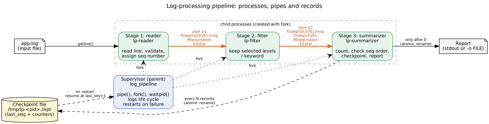

# Log-Processing Pipeline with Interprocess Communication

Operating Systems assignment, **Topic 2: Interprocess Communication Through a Log-Processing Pipeline**
Student ID: 2303037 · GitHub: mahmudul617

A log file is processed by **three separate processes** connected by **pipes**:

```
app.log → [reader] ──pipe p1──▶ [filter] ──pipe p2──▶ [summarizer] → report
               ▲                    ▲                      ▲
               └──────── fork() ── supervisor (parent) ────┘   waitpid(), restart
```

| Process | Name in `ps` | What it does |
|---|---|---|
| Supervisor | `log_pipeline` | creates the pipes and children, waits with `waitpid()`, logs the life cycle, restarts after a failure |
| Reader | `lp-reader` | reads the log file, checks each line's format, numbers it with a sequence number |
| Filter | `lp-filter` | keeps the "selected" events (by severity level and an optional keyword) |
| Summarizer | `lp-summarizer` | counts everything, checks that no record is missing or duplicated, prints the report |

A **single-process version** (`log_single`) does the same work in one loop, without any IPC. Both programs share the parsing code, so for the same input they print **byte-identical reports**. The tests depend on this.



---

## 1. Dependencies

Linux (tested on Ubuntu), plus:

```bash
sudo apt update
sudo apt install -y build-essential python3 python3-matplotlib psmisc graphviz
```

`build-essential` provides gcc and make. `python3` runs the log generator and benchmark, `python3-matplotlib` draws the graphs, `psmisc` provides `pstree`, and `graphviz` (optional) redraws the diagrams.

## 2. Build

```bash
make            # creates bin/log_pipeline and bin/log_single
make debug      # same, with AddressSanitizer + UBSan (for debugging)
make clean
```

## 3. Usage

```bash
./bin/log_pipeline data/sample.log              # report + life-cycle log
./bin/log_pipeline -q data/sample.log           # report only
./bin/log_pipeline -l ALL data/sample.log       # select all levels
./bin/log_pipeline -l WARNING,ERROR -k database data/sample.log
./bin/log_single data/sample.log                # single-process version
```

| Option | Meaning |
|---|---|
| `-l LEVELS` | levels to select: comma separated (`DEBUG,INFO,WARNING,ERROR,CRITICAL`) or `ALL`. Default `ERROR,CRITICAL` |
| `-k WORD` | only select events whose message contains WORD |
| `-o FILE` | write the report to FILE (written atomically) |
| `-q` | quiet: no life-cycle log, only errors and the report |
| `-r N` | maximum restarts after a stage failure (default 3) |
| `-c N` | checkpoint every N records (default 10000) |
| `-x STAGE:SEQ[:always]` | **fault injection**: stage (`reader`, `filter`, `summarizer`) kills itself with SIGKILL at sequence number SEQ |
| `-d USEC` | slows the filter by USEC µs per record (to watch it with `ps`, or to `kill` it by hand) |
| `-w N` | simulated CPU work per record in every stage (performance experiment) |
| `-b BYTES` | kernel pipe buffer size (default 1 MB, `0` = system default 64 KB) |

Exit status: `0` success, `1` usage error / cannot open input, `2` failure after the restarts were used up, `128+sig` when stopped by a signal.

### Input format

```
YYYY-MM-DD HH:MM:SS LEVEL message text
2026-11-15 10:02:00 ERROR Database connection failed (db-1)
```

Lines that do not match are counted as **malformed**, with a reason: `empty_line`, `too_long` (> 1024 chars), `bad_timestamp`, `bad_level`, `missing_message`. They never crash the program.

### Generate test logs

```bash
python3 scripts/gen_logs.py 1000000 data/test.log --malformed 0.02 --seed 42
```

## 4. Tests

```bash
make test        # or: bash tests/run_tests.sh
```

There are 55 checks:

- **Normal cases:** a hand-checked sample file, and the pipeline report compared with the single-process report.
- **Boundary cases:** an empty file, a single line, CRLF line endings, a missing final newline, and a 5000-character line.
- **Malformed entries:** each malformed reason is counted correctly.
- **Equivalence on 100,000 generated lines:** four filter settings, plus an independent check with `grep`.
- **Failure scenarios:**
  - each stage crashes in the middle of the data, and the restarted pipeline's report must equal the single-process report (no loss, no duplicates);
  - the filter is killed from outside with `kill -9`;
  - a stage that fails every time makes the program give up without hanging;
  - SIGTERM to the supervisor leaves no orphan processes;
  - a missing file or a bad option gives a clear error.

## 5. Experiments

```bash
python3 scripts/bench.py          # about 1-3 minutes
bash scripts/observe.sh           # shows ps / pstree / open pipes while running
```

`bench.py` writes `results/environment.txt` (hardware and software), `results/timing.md` (tables), `results/timing_*.csv`, and `results/timing.png`. It only records a timing after checking that both versions produced the same report.

1. **Time vs input size** (1K to 2M lines).
2. **Speedup vs CPU work per record** (`-w`). This shows when the extra processes start to help.
3. **Pipe buffer size** (64 KB, 256 KB, 1 MB).

## 6. Design summary

- **Wire format.** One text line per record, with fields separated by `|`. The message is the last field, so a `|` inside a message is safe.
  - Reader to filter: `R|seq|ts|LEVEL|msg`, `M|seq|reason`, `E|total`.
  - Filter to summarizer: `K|seq|ts|LEVEL|msg` (kept), `D|seq|LEVEL` (dropped), `M|seq|reason`, `E|total`.
  - Dropped records are still sent as a short `D` record so the summarizer can account for every input line.
- **EOF is not the same as success.** A pipe also reaches EOF when its writer crashes. A stage treats its input as complete only after the explicit `E` record. EOF without `E` means exit status 3 ("incomplete").
- **No hangs.** Every process closes the pipe ends it does not use, and the parent closes all of them. A dead stage therefore always causes EOF downstream or `EPIPE` upstream. `SIGPIPE` is ignored in the stages, so they get `EPIPE` and can log it. After a failure the supervisor gives the other stages 2 s to stop, then sends SIGKILL, but only to its own un-reaped children.
- **Restart without loss or duplication.**
  - Every line has a sequence number.
  - The summarizer accepts only `last_seq + 1`. A gap is an error and a duplicate is ignored.
  - Every N records the summarizer saves its counters and `last_seq` atomically (temp file + `rename()`).
  - On failure the supervisor starts a new pipeline. The reader resumes at `last_seq + 1` and the summarizer reloads the checkpoint.
- **Life-cycle log.** Each line shows a millisecond timestamp, role, PID and PPID: process created, exit status or terminating signal, restart.

## 7. Limitations

- The checkpoint survives **process** crashes but not a power failure (no `fsync`, for speed).
- A stage that **hangs** without dying is not detected. A per-stage heartbeat or timeout would fix that.
- The pipeline is strictly linear: one process per stage, so it cannot use more than 3 cores.
- Text serialization is simple to debug, but every record is formatted and parsed again at each stage. This is the main cost measured in experiment 1.

## 8. Project layout

```
src/        pipeline.c (supervisor + 3 stages), single.c, common.c/.h
tests/      run_tests.sh
scripts/    gen_logs.py, bench.py, observe.sh
data/       sample.log (hand-checked)
docs/       communication / hierarchy diagrams (.dot + .png)
results/    benchmark output, sample_output.txt, sample_lifecycle.log
```
